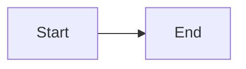

# @vignettes/nuxt

Renders a deck in a Nuxt application: the Reveal layer, the authoring components, the two slide parsers, the theme pipeline and the French orthotypography directive.

```bash
pnpm add @vignettes/nuxt @nuxtjs/mdc
```

```ts
export default defineNuxtConfig({
  modules: ['@nuxtjs/mdc', '@vignettes/nuxt'],
})
```

The module registers the authoring components globally, since a deck body names them in markdown and they are resolved at render time. `RevealPresentation` and `RevealSlides` are ordinary components, so their stylesheets are linked in the server-rendered page. `RevealPresentation` links the theme stylesheet in the document head and covers the deck with a loading veil until Reveal, the theme and the fonts are ready. It exposes the deck composables (`usePresentation`, `useReveal`, `useTheme` and the others of `runtime/composables`) as auto-imports; the slide helpers stay internal. It installs the plugins that seed the theme registry and the typography directive.

The host application defines the routes and provides the content: it decides which page renders a deck, and where the markdown comes from. A page is as short as:

```vue
<script setup lang="ts">
const { presentationData } = usePresentation(useRoute().params.slug as string)
</script>

<template>
  <RevealPresentation
    v-if="presentationData"
    :theme="presentationData.metadata.theme"
    :config="presentationData.metadata.reveal"
    :lang="presentationData.metadata.lang"
  >
    <RevealSlides :presentation-data="presentationData" />
  </RevealPresentation>
</template>
```

`usePresentation(slug)` reads `{ content }`, the deck's markdown, from `/api/presentations/<slug>`, or from the URL given as its second argument. The deck fills the height of the window. A page that shows a deck among other content sets `--vignettes-deck-height` on the deck's container, for instance `100%` on a box with an aspect ratio.

## The deck

A deck is a markdown document with frontmatter:

```yaml
---
title: Presentation title # defaults to the slug
theme: dsfr # a compiled theme name, or one of its aliases
lang: fr # French orthotypography applies when lang is absent or starts with fr
storybook: https://sb.example # root for live story embeds
reveal:
  transition: slide # Reveal options
syntax:
  split: separator # separator (default) or heading
brand: # bloc marque of the French state, drawn by the DSFR themes
  ministry: [Ministère, de l'Intérieur] # République française by default
  slides: cover # cover (default) or all
  onDark: white # white (default) or color
---
```

`brand` puts the bloc marque of the French state at the top of the title slide, or of every slide with `slides: all`: Marianne, the official title on the lines of `ministry`, the motto and, with `operator` and `operatorAlt`, the logo of an operator beside them. On a dark background, `onDark` draws it in white (`white`) or in color on a white plate (`color`). The keys override those the theme's manifest sets, and `brand: false` removes the theme's. A theme built on `@vignettes/theme-dsfr` draws it, and the others leave it out; it is reserved for the services of the state.

## Slides

By default, `---` separates horizontal slides and `----` vertical ones. With `split: heading` under `syntax:` (or the earlier root key `parser: heading`), `#` opens the title slide, `##` starts a horizontal slide, a thematic break (`---`, `***`) outside the title slide starts one too, and `###` nests a vertical slide under it. A line inside fenced code or inside a block component (`::Name` … `::`) never separates slides. `splitSlides` of `@vignettes/core/deck` defines these rules.

Each slide is tagged with the class of its role, which themes style: `slide-h1` for the title slide, `slide-h2` for a section, `slide-h3` for a content slide. A section is a `##` slide made of its heading and at most one paragraph of 140 characters or fewer, besides its `::Notes` and its annotations other than `:layout`; `isSectionSlide` of `@vignettes/core/deck` defines this rule. A `##` slide with more content carries `slide-h3`, and the keys of `backgrounds` follow the same roles. A section holding vertical slides is wrapped in Reveal's stack, which carries `stack-h1` or `stack-h2` and no `slide-` class: the wrapper is not a slide, so a rule written for a slide role cannot reach the slides nested under it.

## Annotations

An annotation is a `:tag{...}` directive the parser reads and removes from the body.

- `:pretitle{text="…"}` writes a text above the heading.
- `:subtitle{text="…"}` writes a text below the heading.
- `:slide-background{image="…"}` sets the background of this slide, over the theme's.
- `:layout{media="…" …}` places a media beside, above, below or behind the text, and sets the heading.
- `:quicklink{text="…" href="…"}` pins a link at the bottom of the slide.

`:layout` takes these attributes, defined once in `packages/core/src/deck/layout.ts`:

- `media`: `right`, `left`, `top`, `bottom` or `behind`. A `src` or a `story` without `media` goes to the right.
- `size`: `1/3`, `1/2`, `2/3` or `3/4`, the share of the slide the media takes, of its width on a side and of its height at the top or the bottom. A side media takes `1/2` by default; at the top or the bottom, the media takes the height the text leaves. At `2/3` and `3/4` on a side, the text shrinks to fit its column.
- `src`, or `story` for a story of the deck's Storybook, and `type` (`image` or `iframe`). Without `type`, a `src` ending with an image extension is an image and any other a page.
- `fit` (`cover` by default, `contain`) and `position` (`center` by default, `top`, `bottom`, `left`, `right`) frame the media.
- `alt` describes the media, `lightbox` opens it full screen on a click, `hint` writes a text with an arrow towards it at the bottom of the text column.
- `viewport`, `1440` by default, is the width in pixels a page or a story is laid out at before it shrinks to its pane.
- `veil`, behind the text only, lays a dark veil over the image, as a percentage, and writes the text in light colors; without a veil, the text sits on a card.
- `heading`: `compact` keeps the heading to one line, for a tall gallery; `hidden` hides it; `print` hides it on screen only.
- `screen`, on a slide without a media pane, gives the screens of the body (`::StoryFrame`, `::Screens` of `@vignettes/storybook`) the whole height the heading leaves, and keeps the heading to one line unless `heading` names another mode.
- `align`: `top`, `center` or `bottom`, the vertical alignment of the content: of the heading and the text on a title or a section slide, of the body under the heading on a content slide, of the text in its column beside a media, of the text card over an image. By default, the content is centered; a caption column at `3/4` and a text above or below a media start at the top; the card over an image sits at the bottom.

The media pane extends to the edge of the slide and the text keeps its margins. A media behind the text is the slide background, over the whole screen and the printed page. The phone's scroll view stacks the text and the media.

The parser also reads the attributes of decks written before `media` and `size`: `name="media-right"`, `-wide`, `-xwide`, `media-below`, `media-above`, `media-cover` and `grid-compact`, `previewWidth`, and the `FullScreenImage` and `SplitSlide` components.

## Components

MDC uses colons, and the count says what the component wraps: `:::Name` a container of other components, `::Name` a leaf wrapping text, `:name{…}` an inline. A parent container always takes more colons than its children. A `boolean` or `number` attribute takes a colon and a JSON value, as `:preview="true"`: without the colon, its value is the text (see [Addresses and bound attributes](#addresses-and-bound-attributes)).

The module ships the components below. Two more modules extend the set: `@vignettes/schemas` for the explanation kit, `@vignettes/storybook` for live story embeds. A tenant declares its own components the same way, with `registerDeckComponents` from `@vignettes/core/deck`.

### Quote

<!-- component: Quote -->

```markdown
::Quote{author="Author" role="Role"}
The quote.
::
```

Attributes:

- `author` (`string`): Name of the person quoted.
- `role` (`string`): Role of the person quoted, under the name.
- `avatar` (`string`): Address of a portrait beside the name.

Content: The quote, in markdown.

<!-- /component -->

### Highlight

<!-- component: Highlight -->

```markdown
::Highlight
Key message.
::
```

Attributes:

- `size` (`'sm' | 'md' | 'lg' | 'xl'`): Text size of the message, a step of the type scale above the body text; without it, the message keeps the size of the body text.

Content: The message, in markdown.

<!-- /component -->

### Fragments

<!-- component: Fragments -->

Also written `fragments`.

```markdown
::Fragments
- First point
- Second point
::
```

Attributes:

- `effect` (`string`, default `'fade-in'`): Reveal fragment effects, separated by spaces: `fade-in`, `fade-up`, `fade-left`, `grow`, `highlight-current-blue`, `fade-up grow`…
- `dim` (`boolean`, default `false`): Dims the items already shown once a later one is current.
- `collapse` (`boolean`, default `false`): With an effect that shows an item at its step, the items still hidden take no space: the slide lays out its content again at each step, and an item appears with a fade.

Content: A markdown list, whose items appear one at a time; each other block is one step.

<!-- /component -->

### IconInline

<!-- component: IconInline -->

Also written `i`.

```markdown
:i{name="ri:home-line"}
```

Attributes:

- `name` (`string`, required): Iconify name of the icon, `ri:home-line`; the Remix class `ri-home-line` works too.
- `size` (`string | number`, default `'1.2em'`): CSS size of the icon.

<!-- /component -->

### Columns

`Columns` lays its children side by side. Without `Column` children it splits the body at a horizontal rule or at each `H3` or `H4`; with `Column` children the breaks are theirs.

<!-- component: Columns -->

Also written `TwoColumns`, `ThreeColumns`.

```markdown
:::Columns
::Column
Column 1
::
::Column
Column 2
::
:::
```

Attributes:

- `size` (`'xs' | 'sm' | 'md' | 'lg' | 'xl'`, default `'md'`): Text scale of the columns.

Content: `::Column` blocks, or markdown that splits in two at its first horizontal rule, or else before each `###` or `####` heading.

<!-- /component -->

### Column

<!-- component: Column -->

Also written `column`.

```markdown
::Column
Column content
::
```

Attributes:

- `span` (`number | string`): Weight of the column in the row: `span="2"` beside `span="1"` gives two thirds and one third.
- `ratio` (`string`): Width of the column as a fraction of the row: `2/3`, `1/4`.

Content: The text of the column, in markdown.

<!-- /component -->

### Image

<!-- component: Image -->

Also written `deck-image`.

```markdown
::Image{src="/images/placeholder.svg" alt="Description"}
::
```

Attributes:

- `src` (`string`, required): Address of the image.
- `alt` (`string`, default `''`): Text alternative of the image.
- `width` (`string`, default `'auto'`): CSS width of the image.
- `height` (`string`, default `'auto'`): CSS height of the image.
- `fit` (`'contain' | 'cover' | 'fill' | 'none' | 'scale-down'`, default `'contain'`): CSS `object-fit` of the image in its box.
- `position` (`string`, default `'center'`): CSS `object-position` of the image in its box.
- `rounded` (`boolean`, default `false`): Rounds the corners.
- `shadow` (`boolean`, default `true`): Draws a shadow under the image.
- `preview` (`boolean | string`): Opens the image full-screen on click: `true` shows `src`, an address shows another image.

Content: The caption, in markdown.

<!-- /component -->

### Iframe

<!-- component: Iframe -->

```markdown
::Iframe{src="https://example.com" title="Title"}
::
```

Attributes:

- `src` (`string`, required): Address of the page.
- `title` (`string`, default `''`): Accessible title of the frame.
- `width` (`string`, default `'100%'`): CSS width of the frame.
- `height` (`string`, default `'500px'`): CSS height of the frame.
- `allow` (`string`, default `'accelerometer; autoplay; clipboard-write; encrypted-media; gyroscope; picture-in-picture'`): Permissions policy of the frame, its `allow` attribute.
- `frameborder` (`string`, default `'0'`): The `frameborder` attribute of the frame.
- `fullwidth` (`boolean`, default `true`): Stretches the frame to the width of its column.
- `lightbox` (`boolean`, default `false`): Opens the page full-screen on click.

<!-- /component -->

### Mermaid

`Mermaid` draws a diagram in the colors and the font of the theme, and reduces it, without enlarging it, to fit the width of its column and the height the other blocks of the slide leave; the diagrams of one slide take the same reduction. For sequence diagrams it sets `mirrorActors: false`, `width: 180`, `actorMargin: 30`, `messageMargin: 14`, `boxMargin: 4`, `noteMargin: 6`, `diagramMarginY: 4` and `wrap: true`. A `%%{init: …}%%` block at the top of the diagram overrides these values.

<!-- component: Mermaid -->

````markdown
::Mermaid

::
````

Attributes:

- `theme` (`'default' | 'dark' | 'forest' | 'neutral'`): A Mermaid theme; without it, the diagram takes the colors and the font of the deck theme.
- `steps` (`string`): Reveal steps as node-id groups: `A,B|C|D` shows A and B, then C, then D; edges follow their later node.

Content: A fenced code block in `mermaid`.

<!-- /component -->

### Notes

`Notes` renders Reveal's speaker notes, shown in the speaker view opened with the `S` key.

<!-- component: Notes -->

Also written `notes`.

```markdown
::Notes
What the speaker says.
::
```

Content: The notes, in markdown.

<!-- /component -->

## Addresses and bound attributes

An address in a deck, for `storybook`, a `src`, an `href`, a markdown link or `:slide-background`, is an `http://` or `https://` URL or a path on the site that shows the deck. An image also takes a `data:image` URL; a component lists its image props under `images` in its declaration. `isDeckUrl` of `@vignettes/core/deck` defines the rule: the schema reports another address, the parser and the renderer remove it, and the editor marks it in the `{…}` attributes of a component, an annotation or a span, and in an inline markdown link or image.

An attribute written with a colon, as `:preview="true"`, takes a JSON value: `true`, `2`, `"text"`, an array or an object. The parser removes a bound attribute whose value is not JSON, and the directives `v-bind`, `v-on`, `@` and `v-model`.

Each frame of a slide carries a sandbox and the `strict-origin-when-cross-origin` referrer policy. A frame keeps the origin of its page, except a file an account uploaded to the site (`/media/`, see `isUploadedFile`), which runs in an opaque origin, without its cookies and storage.

## Themes

A theme is a directory with a `theme.json` manifest and an SCSS entry that builds on `@vignettes/theme-kit`. The module compiles the themes it discovers in the application and in the content space to `public/themes/` when Nuxt starts, in development and for a build, and watches them in development. An application that compiles its themes in its own build script sets `vignettes: { compileThemes: false }`. `docs/theme-system.md` of the repository describes the theme system.
